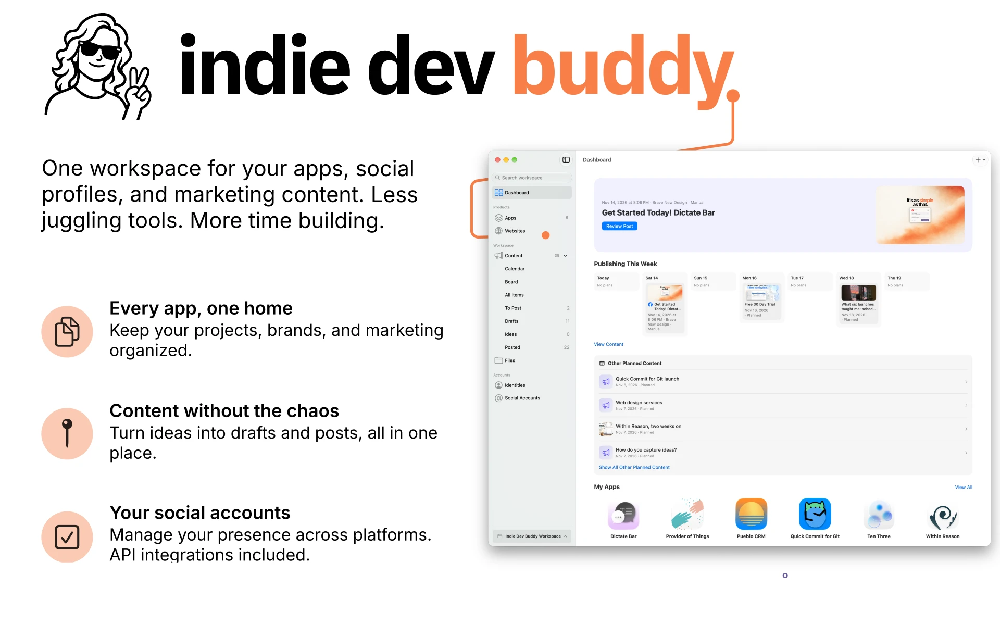
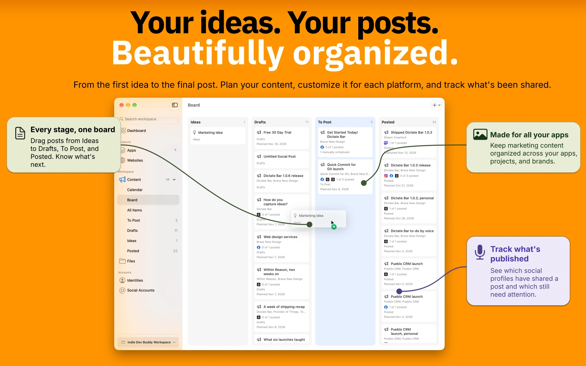
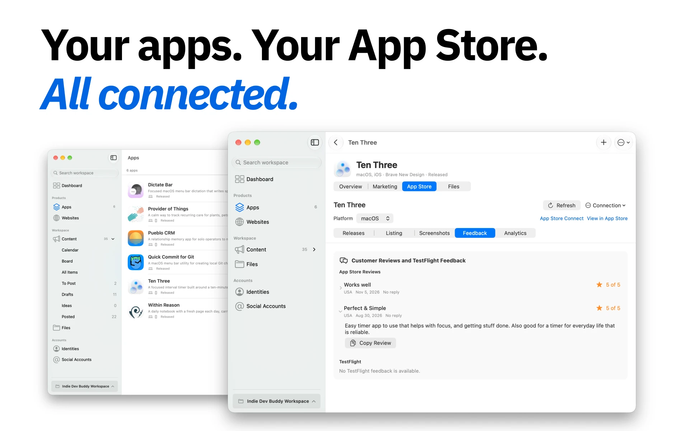
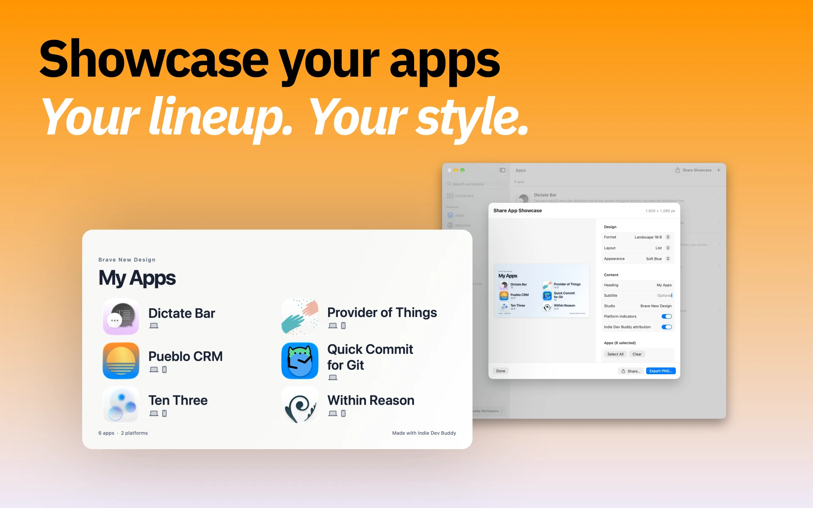

# Indie Dev Buddy

Indie Dev Buddy is a macOS workspace for indie software makers to organize apps, prepare marketing content, manage social publishing, and work with App Store Connect. People and AI agents can work with the same workspace through the app, the bundled command-line tool, and workspace files.

**Status:** Early access. This release is a Mac app with workspace data stored as ordinary files in a folder you choose. It has no hosted account service or cloud scheduler.

## Download

Download the signed, notarized Apple silicon build from [GitHub Releases](https://github.com/BraveNewDesign/Indie-Dev-Buddy/releases/latest). Open the DMG and drag Indie Dev Buddy to Applications. Requires macOS 27.2 or later. The app checks for updates through Sparkle.

## Features

### App and workspace management

- Organize apps, identities, websites, social accounts, and marketing content in a workspace folder.
- Track app descriptions, platforms, development status, bundle IDs, icons, project folders, repository links, App Store links, TestFlight links, and related website pages.
- Associate product, support, privacy, and other website links with apps.
- Browse, import, open, rename, and move workspace files to Trash.
- Switch between workspaces and rename the workspace display name without moving its folder.
- Detect external workspace edits and handle conflicts when a record changes while it is being edited.

### AI agent–ready CLI and workspace guidance

Indie Dev Buddy includes `indiedevbuddy`, a command-line tool designed for AI agents as well as people using Terminal or scripts. Agents can call it through their existing terminal tools, with no MCP server to install, configure, or keep running.

Every workspace includes agent instructions and reference material: an `AGENTS.md` describing the recommended workflow and safety rules, workspace data-format documentation and examples, and an Indie Dev Buddy marketing content skill under `.agents/skills/`. This gives agents context about the workspace structure and supported operations, helping them use the CLI and follow workspace conventions without guessing.

The CLI returns structured JSON and supports explicit workspace paths, revision checks, and workspace validation. Agents can inspect the latest record before editing, detect stale changes, and validate the workspace after a task.

With the CLI, agents can:

- List and read apps, websites, identities, social accounts, and marketing content.
- Create blog, social, and idea drafts; update records and original draft text.
- Manage workspace files and folders, including importing, renaming, moving items to Trash, and confirmed removal.
- Create, register, inspect, rename, and forget workspaces.
- Validate workspace records and asset references.

The CLI manages workspace data. Social account connections, scheduling, and publishing are app actions.

### App Store Connect

Connect an app through the installed and authenticated `asc` command-line tool. Indie Dev Buddy can:

- Find App Store Connect apps by app name or bundle ID, link one to a workspace app, and selectively import its name, bundle ID, and App Store listing URL.
- View live and latest version status, latest build processing state, App Review status, and recent submission history.
- Browse localized listing information, including app name, subtitle, description, categories, keywords, promotional text, support and marketing URLs, and “What’s New” text.
- Review submission readiness findings returned by `asc`.
- View customer reviews and TestFlight feedback, and copy review text.
- Browse and preview screenshots already in App Store Connect, then import selected images into workspace Files.
- View available analytics reports for first-time downloads, redownloads, total downloads, product page views, and impression events.
- Edit and copy localized “What’s New” text as a draft, create a marketing draft from it, or prepare release notes from a selected Git tag or commit.

App Store Connect access is read-only. Indie Dev Buddy does not upload listing metadata or screenshots, submit versions, or respond to reviews. Analytics depend on reports already configured in App Store Connect and permissions available to the active `asc` profile. The app shows individual customer reviews; it does not provide an aggregate star-rating dashboard.

### Marketing content and planning

- Write Markdown blog articles, social posts, and ideas.
- Organize content in a calendar, workflow board, and lists for drafts, items to post, and posted content.
- Associate content with apps, websites, source articles, and related posts.
- Create a social post from an article and optionally include the article’s published link.
- Share one original post across accounts, then customize text and media for individual accounts.
- Preview the content for each selected social account and see configurable character-count guidance.
- Copy effective post text and images for manual publishing.
- Track draft, ready, manually scheduled, scheduled, and published status, with publication dates and URLs.

### Social accounts and publishing

Connect accounts and publish or schedule through provider APIs where supported:

- **API connections and local scheduling:** Bluesky, Facebook Pages, Threads, Instagram, X, LinkedIn, and Mastodon.
- **Manual planning and posting:** GitHub accounts and custom platforms.

Manage account owners and profile details, check connection status, and review posts and comments through the account activity view where providers allow it. Depending on the provider and granted permissions, activity actions can include replying, liking or unliking, reposting or undoing a repost, and hiding or deleting comments. Bluesky mentions can be resolved before scheduling.

API schedules run on the Mac: the app must be open and the Mac awake at the scheduled time. Manual schedules are reminders and never send posts. Scheduled API posts retain the approved text, media, recipient, and time until explicitly rescheduled. Delivery history helps review completed, missed, or uncertain attempts.

For Instagram and Threads, Indie Dev Buddy can publish an image using a public HTTPS media URL or upload a JPEG to a user-configured Cloudflare R2 bucket for a one-time publish. Provider permissions, account setup, and supported media formats determine availability.

### Asset library and App Store screenshots

- Import and organize reusable assets in folders; add tags and browse recent or unfiled items.
- Search and filter assets, preview them, open or reveal them in Finder, and duplicate them.
- Create screenshot sets by app, platform, localization, and version.
- Add, replace, and reorder screenshots; check image dimensions and required display coverage.
- Import selected screenshots from App Store Connect into workspace Files.

### App showcases

Create a shareable app lineup image with selected apps, grid or list layouts, output formats, light or dark appearance, headings, studio details, and optional attribution. Preview the artwork, export a PNG, or share it from the app.

## What to expect

- You configure provider access and account permissions. See [Social connections](docs/SOCIAL_CONNECTIONS.md) for setup and supported actions.
- Social provider credentials are stored in the macOS Keychain. Workspace account records contain profile metadata, not provider tokens.
- Scheduled API delivery requires Indie Dev Buddy to be running and the Mac to be awake at the scheduled time. The app does not provide a cloud scheduler.
- App Store Connect uses your installed, authenticated `asc` CLI. Access and data availability depend on its active profile and permissions.
- Indie Dev Buddy is not affiliated with or endorsed by Apple, Meta, Bluesky, Mastodon, LinkedIn, X, or GitHub.

## Screenshots

  

## Build

The released app currently supports Apple silicon and requires macOS 27.2 or later. Building from source requires Xcode 27.2 or later. Open `Indie Dev Buddy.xcodeproj` in Xcode and build the **Indie Dev Buddy** scheme.

The project depends on the public SocialKit package at version 0.1.0. Publish the matching `v0.1.0` SocialKit tag before building a fresh clone.

The direct-download release path and Sparkle update setup are documented in [Direct distribution](docs/DIRECT_DISTRIBUTION.md).

## Documentation

- [Browse the documentation website](https://bravenewdesign.github.io/Indie-Dev-Buddy/documentation/)
- [Getting started with the Mac app](docs/GETTING_STARTED.md)
- [Social account setup and publishing behavior](docs/SOCIAL_CONNECTIONS.md)
- [Workspace command-line guide](docs/CLI_GUIDE.md)
- [GUI and CLI capability matrix](docs/CLI_CAPABILITY_MATRIX.md)
- [AI agent development pack](docs/README.md)
- [Social icon sources and attribution](docs/SOCIAL_ICON_SOURCES.md)

See [CONTRIBUTING.md](CONTRIBUTING.md) for pull request and documentation editing guidance.

## License

Indie Dev Buddy is licensed under the [MIT License](LICENSE). Third-party artwork and platform marks remain subject to their respective licenses and brand guidelines; see the icon source notes in this repository.
